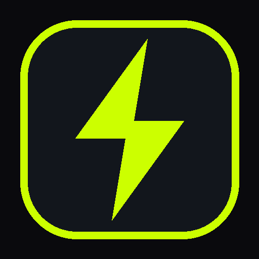

# ⚡ RunOverlay - Social Running Overlay Generator

A mobile-friendly, client-side web application designed to generate high-resolution, customizable running overlays for social media (Instagram Stories, Reels, TikTok, Strava, Twitter/X, and video editors like CapCut). Similar to **RunCut**, **RunStory**, and **Velographic**.

Ready to be hosted directly on **GitHub Pages** with **zero build step**!



---

## 🚀 Key Features

### 1. 📁 Multi-Format Activity Support
* **`.fit`**: Garmin, Wahoo, Coros, Suunto binary files (powered by Garmin's official Fit SDK).
* **`.tcx`**: Garmin Training Center XML files (with native device workout laps).
* **`.gpx`**: Standard GPS track format with elevation, heart rate, and cadence extensions.
* **⚡ 4 Built-In Demo Activities**:
  * **Morning 5K Speedrun** (Negative split progression)
  * **Scenic 10K Trail** (Undulating elevation profile & climbs)
  * **Sunday Half Marathon** (21.1 km long run telemetry)
  * **Track Intervals (8 x 400m)** (Workouts with native interval laps)

### 2. ⚡ Per-Km Splits & Workout Laps (High Customizability)
* **Dual Split Source**:
  * **1-Km / 1-Mile Splits**: Automatically calculated using great-circle Haversine formulas.
  * **Device Workout Laps**: Preserves native laps recorded by your Garmin or fitness watch (e.g. interval repeats).
* **Splits Bar Chart Widget**:
  * Visual comparative bar chart of all splits.
  * Fastest split automatically spotlighted in glowing accent color (`⚡`).
  * Shows split pace, duration, and elevation changes.
* **Split Focus / Spotlight Card**:
  * Highlight a single key split of your run:
    * ⚡ **Fastest Split** (PB)
    * 🐢 **Slowest Split**
    * 🏁 **Final Kick** (Last Split)
    * 🎯 **Specific Km / Lap** (Selected via dropdown or clicking any row in the splits table!)
  * Displays big split pace, split duration, split heart rate, elevation change, and distance.
* **Interactive Splits Table**: Detailed breakdown table showing Split #, Time, Pace, Avg HR, and Elevation.

### 3. 📊 Full Suite of Available Widgets
* 🏷️ **Activity Header**: Title (editable), Date, Time, Runner Handle (`@runner`), Location, and Weather badge.
* 🗺️ **GPS Route Map**:
  * Smoothed polyline with Mercator aspect-ratio correction.
  * Color modes: **Solid Accent**, **Pace Gradient** (green/cyan for fast, red for slow), or **Heart Rate Gradient** (Zone 1 to Zone 5).
  * Neon glowing track shadow.
  * Start (green) and Finish (red/checkered) pins.
* 🏆 **Hero Metric**: Large bold focal number (Distance, Moving Time, or Avg Pace).
* 📊 **Secondary Metrics Grid**: Customizable cards for Moving Time, Avg Pace, Best Pace, Avg HR, Elevation Gain, Cadence (SPM), and Calories (kcal).
* ⛰️ **Elevation Profile Chart**: Area graph showing terrain altitude, climbs, descents, and min/max elevation.
* ❤️ **Heart Rate Zones Bar**: 5-zone distribution bar (Z1 Recovery, Z2 Easy, Z3 Aerobic, Z4 Threshold, Z5 Anaerobic).
* ⚡ **Brand / Social Watermark**: Strava-inspired badge, Nike Run Club style, or custom athlete tag.

### 4. 🎨 Themes & Background Customization
* **Aspect Ratios**:
  * **9:16** (Instagram Stories, Reels, TikTok — 1080 × 1920)
  * **1:1** (Square Post — 1080 × 1080)
  * **4:5** (Portrait Feed Post — 1080 × 1350)
  * **16:9** (Landscape Video / Banner — 1920 × 1080)
* **Background Types**:
  * **User Photo**: Upload your running photo with interactive **Pan X/Y, Zoom, Blur, Brightness, and Contrast**.
  * **Dark Protective Gradient**: Built-in vignette ensures white stats text is 100% legible against bright outdoor photos!
  * **Solid AMOLED / Dark**: Pure Black `#000000`, Deep Slate, Crisp White.
  * **Gradients**: Sunset Glow, Cyber Neon, Tokyo Synthwave.
  * **Transparent**: Generates transparent PNGs ready to overlay directly into video editors (CapCut, Premiere) or as Instagram Story stickers!
* **Color Themes**:
  * Cyber Volt (`#ccff00`)
  * Strava Orange (`#fc5200`)
  * Tokyo Neon Cyan (`#00f0ff`)
  * Hot Coral (`#ff3366`)
  * Minimal White (`#ffffff`)
  * Champion Gold (`#fbbf24`)
  * Custom Hex Color Picker
* **Card Styles**: Glassmorphism (translucent blur), Solid Dark, Outline, or Floating Text.
* **Typography**: Athletic Bold (Anton/Bebas Neue), Modern Clean (Inter), Tech HUD (Rajdhani), or Telemetry Mono (JetBrains Mono).

### 5. 💾 High-Res Export & Mobile Sharing
* **Resolution**: HD 1080p, Ultra 2X (2160p), or Max 4K (3840p).
* **Format**: Lossless PNG or compressed JPEG.
* **Web Share API**: One-tap **"Share to Socials"** directly opens the native mobile share sheet (Instagram Stories, WhatsApp, TikTok, etc.) on iOS and Android!
* **Clipboard Copy**: Direct "Copy to Clipboard" for instant pasting into chats or stories.

---

## 🌐 How to Host on GitHub Pages (Free in 2 Minutes)

Because this app is built with pure, modern client-side standards (HTML5 Canvas + ES Modules), it requires **zero build commands**, zero Node.js servers, and is completely private (your running files and photos never leave your device).

1. **Create a GitHub Repository**:
   * Create a new repository on [GitHub](https://github.com/) (e.g. `running-overlay`).
2. **Push your code**:
   ```bash
   git init
   git add .
   git commit -m "Initial commit of RunOverlay"
   git branch -M main
   git remote add origin https://github.com/<your-username>/<your-repo-name>.git
   git push -u origin main
   ```
3. **Enable GitHub Pages**:
   * In your repository on GitHub, go to **Settings** → **Pages** (under the "Code and automation" section).
   * Under **Build and deployment** → **Source**, select **Deploy from a branch**.
   * Under **Branch**, select `main` and folder `/ (root)`, then click **Save**.
4. **Done!**
   * Within 1–2 minutes, your web app will be live at:
     `https://<your-username>.github.io/<your-repo-name>/`

---

## 💻 Local Development & Testing

You can run a local test server using Python:

```bash
# In the project directory:
python -m http.server 8000
```

Then open your browser at:
`http://localhost:8000`

---

## 📱 Mobile-First Tips
* **Add to Home Screen**: On iOS Safari, tap "Share" → "Add to Home Screen". On Android Chrome, tap menu → "Install app" to use it full-screen like a native app.
* **Pinch & Drag**: When using a background photo, drag directly on the preview canvas to reposition the photo!
* **Transparent Video Overlays**: Export as transparent PNG, import into CapCut or Instagram Stories as an overlay sticker over your running video.

---

## 🔒 Privacy
RunOverlay is 100% client-side. All `.fit`, `.tcx`, `.gpx` files and photos are processed in your browser memory and never uploaded to any server.
